<h1 align="center">Bot Traffic Econometrics</h1>

<p align="center">
  <em>Causal decomposition, censored-telemetry Manski bounds, O(N * D) multivariate Hawkes processes, and Stackelberg channel-displacement games for adversarial bot telemetry (compiled Rust core + typed Python).</em>
</p>

<p align="center">
  <a href="https://github.com/adeoluo/bot-traffic-econometrics/actions/workflows/ci.yml"></a>
  <a href="https://github.com/adeoluo/bot-traffic-econometrics/releases"></a>
  
  
  <a href="LICENSE"></a>
</p>

---

## Published Research Context & Media Coverage

Security telemetry looks deceptively simple until you ask whether a headline metric moved because
**attackers changed behavior**, **customer cohorts rotated**, **human traffic diluted the
denominator**, or **interstitial CAPTCHAs censored client-side sensors**.

This library formalizes and generalizes the econometric, partial-identification, and point-process
methods motivated by my published **F5 Labs** threat-research study and subsequent industry
analysis:

- **Primary Research Paper (F5 Labs, Nov 18, 2026)** - Adeolu Ogunnoiki,
  [*"Automation leading up to Black Friday"*](https://www.f5.com/labs/articles/2026-black-friday-bot-report)
  ([Full PDF](https://cdn.sanity.io/files/k6fem79d/translations-production/1d1028afb94e20d907a0b98ef084535e84fc9cd5.pdf) ·
  [F5 Labs Author Page](https://www.f5.com/labs/authors/adeolu-ogunnoiki))
- **Executive CISO Commentary (F5 Blog, Nov 19, 2026)** - Sean Murphy (North America Field CISO, F5),
  [*"The Black Friday automation trend everyone gets wrong"*](https://www.f5.com/company/blog/the-black-friday-automation-trend-everyone-gets-wrong)
- **External Security Press (*Dark Reading*, Nov 19, 2026)** - Alexander Culafi,
  [*"Why Holiday Security Can't Wait for Black Friday"*](https://www.darkreading.com/cybersecurity-operations/why-holiday-security-cant-wait-black-friday)

> **Data boundary:** No proprietary customer telemetry is included in this repository. All bundled
> panels and point-process traces are synthetic or calibrated exclusively to public aggregate moments
> published in the open F5 Labs report above.

---

## Architecture

<p align="center">
  
</p>

<sub>Legend: amber = telemetry inputs and entry points, indigo = compiled Rust hot-path engines (`_bte_rs`), blue = causal identification and equilibrium solvers, green = differential `SciPy` parity gate, grey = empirical and policy outputs.</sub>

Every install compiles the **Rust extension (`bot_traffic_econometrics._bte_rs`, PyO3 + Rayon)**
and routes hot paths through it automatically (`USING_RUST == True`), while keeping pure-Python /
NumPy reference implementations in-tree so every estimator is differential-tested against both
the Python reference and `SciPy` in CI.

---

## Five Measurement Traps & Mathematical Formulations

### 1. Cohort Churn vs Behavioral Shift (`panel.py` + Rust Rayon Bootstrap)

When enterprise panels gain and lose heavy-tailed tenants across seasons, headline rate shifts
$\Delta R = R_1 - R_0$ conflate attacker behavior with entry/exit selection. Partitioning entities
into **Survivors** $S = E_0 \cap E_1$, **Exiters** $X = E_0 \setminus E_1$, and **Entrants**
$M = E_1 \setminus E_0$ yields an **algebraically exact (zero-residual)** 4-way Melitz-Polanec +
symmetric Kitagawa decomposition:

$$\Delta R = \underbrace{\sum_{i \in S} \bar{w}^S_i (r_{i,1} - r_{i,0})}_{\text{Within-survivor behavior}} + \underbrace{\sum_{i \in S} (w^S_{i,1} - w^S_{i,0}) \bar{r}_i}_{\text{Survivor share reallocation}} + \underbrace{(1 - s_1)(R^M_1 - R^S_1)}_{\text{Entry selection}} + \underbrace{(1 - s_0)(R^S_0 - R^X_0)}_{\text{Exit selection}}$$

Uncertainty is quantified via a **Rubin Bayesian (Dirichlet) entity-cluster bootstrap** (`Exp(1)`
entity weights parallelized with `rayon` in Rust), which remains smooth when power-law retail giants
carry 20%+ of cohort volume.

### 2. Event-Day Denominator Dilution & Trend Instability (`surge.py`)

In the F5 Labs study, Black Friday's automation **rate** dipped below the November baseline in all
three years (`11.6%`, `14.8%`, `14.6%` vs `15.3%`, `17.8%`, `24.5%`), even though raw bot volume
**rose** `+20%` (2023) and `+17%` (2024) beneath `+61%` and `+54%` human shopper surges.
`attribute_surge_shapley` applies exact two-player **Shapley-Owen attribution** to
$R(B, H) = \frac{B}{B + H}$:

$$\phi_B = \tfrac{1}{2}\big[(R(B_1, H_0) - R(B_0, H_0)) + (R(B_1, H_1) - R(B_0, H_1))\big], \quad \phi_H = \Delta R - \phi_B$$

cleanly separating upward bot-volume impulses ($\phi_B > 0$) from downward human-denominator
dilution ($\phi_H < 0$). `assess_pre_event_trend` pairs exact **Theil-Sen median slopes** with
tie-corrected **Mann-Kendall $\tau_b$** tests over `BF-k` windows (showing why 13 of 14
flow-subindustry series flip pre-event slope signs across years).

### 3. Interstitial Challenge Censoring: Sharp Manski Bounds & Multi-Flow EM (`censoring.py`)

When $c \in [0.239, 0.795]$ of flagged automated requests hit interstitial CAPTCHAs or JS challenges
before client-side behavioral sensors execute, latent bot sophistication $v_S \in \{0.0, 0.5, 1.0\}$
is non-randomly censored:

- **Sharp Distribution-Free Manski Bounds:** $I^* \in [(1 - c)I_U,\; (1 - c)I_U + c]$ of exact
  width $c$. At 2024's `79.5%` challenge rate, the assumption-free interval has width `0.795`,
  proving mathematically that naive `2023 -> 2024` sophistication jumps (`0.07 -> 0.23`) are
  **sign-ambiguous without selection assumptions**, whereas `2024 -> 2025` (`0.23 -> 0.98` at
  `41.3%` censoring) is **strictly increasing** under adverse interception ($\mathbb{E}[v_S \mid C=1] \le I_U$).
- **Joint Multi-Flow EM Solver:** Estimates flow-specific latent mixes $\pi_f \in \Delta^2$ and
  shared tier challenge propensities $\gamma \in (0, 1)^3$ across flows with varying challenge
  policy exposure $e_f \in (0, 1]$ via 1-D concave Newton/bisection M-steps in Rust.

### 4. $O(N \cdot D)$ Multivariate Marked Hawkes Processes (`hawkes.py`)

Models calendar-agnostic self-exciting bot bursts (peaking at `BF-23`, `BF+1`, and `BF-38` rather
than calendar holidays) across $D$ `{Channel x Flow}` dimensions. Using Ozaki's state recursion
$g_j(r) = e^{-\beta(t_r - t_{r-1})}(g_j(r-1) + \mathbf{1}[m_{r-1}=j])$:

- Evaluates exact log-likelihood and analytical gradients $(\nabla_\mu \ell, \nabla_A \ell)$ in
  **$O(N \cdot D)$** time rather than $O(N^2)$, and
- Runs **exact $O(N \cdot D)$ Lewis-Mohler Expectation-Maximization** using summed mark
  responsibilities $S_{i,j} = \sum_{r: m_r=i} \alpha_{i,j} g_j(r) / \lambda_i(t_r^-)$ with
  guaranteed non-negativity and monotonic likelihood ascent.

### 5. Stackelberg Web-vs-Mobile-API Displacement Game (`game.py`)

Formalizes the cross-channel substitution risk highlighted in the F5 Labs report (`33x -> 14x -> 12x`
Web-to-Mobile-API automation ratio compression) and Sean Murphy's Field CISO blog: when a
budget-constrained defender hardens Web endpoints alone ($u_W > 0, u_M = 0$), a cost-minimizing
adversary with cross-channel capacity coupling $\gamma > 0$ displaces **+135.8%** additional attack
mass onto Mobile APIs. Solving the **Stackelberg leader equilibrium** co-allocates Web and Mobile
API friction and cuts residual weighted attack damage by **22.1%** at the exact same defense budget.

---

## Reproducing the 2026 F5 Labs Empirical Findings

Run `uv run bot-econometrics` (or `--json` for structured output; committed artifact in
[`benchmarks/results/f5_reproduction.json`](benchmarks/results/f5_reproduction.json)):

| Empirical Phenomenon (Ogunnoiki, F5 Labs 2026) | Headline Metric | Econometric / Structural Decomposition |
|---|---|---|
| **2023 -> 2024 Panel Shift** | `17.4% -> 18.5%` (`+1.1 pp`) | Same-store survivors **fell** `21.6% -> 18.1%` (`-3.4 pp` within-cohort); `+4.5 pp` composition lift from `<2%` bot retailers exiting |
| **2024 -> 2025 Panel Shift** | `18.5% -> 28.6%` (`+10.1 pp`) | Same-store survivors **surged** `16.7% -> 29.8%` (`+13.1 pp` within-cohort behavioral escalation; `-3.0 pp` composition offset) |
| **Black Friday 2023 & 2024 Rate Dips** | `15.3% -> 11.9%` & `17.8% -> 14.1%` | **Diluted bot surges:** positive bot impulses (`+2.15 pp`, `+2.11 pp`) masked by human-shopper denominator dilution (`-5.58 pp`, `-5.78 pp`) |
| **Black Friday 2025 Rate Dip** | `24.5% -> 15.0%` | **Genuine contraction + dilution:** both bot impulse (`-3.88 pp`) and human dilution (`-5.58 pp`) moved negative |
| **Interstitial Challenge Censoring** | Uncensored index `0.07 -> 0.23 -> 0.98` | `79.5%` censoring in 2024 yields sharp Manski bounds `[0.06, 0.86]` (`2023 -> 2024` sign-ambiguous; `2024 -> 2025` strictly increasing under adverse interception) |
| **Flow Rate vs Volume-Share Paradox** | Ecommerce `add_to_cart` `54.2%` rate; QSR `gift_card` `10.1%` rate | Rank inversion: `session_create` carries **85%** of Ecommerce bot volume; `login` carries **77%** of QSR bot volume |

---

## Differential Validation Against `SciPy` & Rust Performance

Correctness is verified in CI (`tests/test_rust_and_scipy_parity.py`) across Python 3.12-3.15
against independent `SciPy` numerical routines and exact algebraic identities:

| Quantity | Independent Reference | Max Absolute Discrepancy |
|---|---|---:|
| 4-way unbalanced panel identity | $\Delta_{\text{within}} + \Delta_{\text{realloc}} + \Delta_{\text{entry}} + \Delta_{\text{exit}} = R_1 - R_0$ | **< 1e-15** |
| Rust vs Python panel decomposition | `_decompose_python` (NumPy float64) | **< 1e-14** |
| Joint Theil-Sen slope & intercept | `scipy.stats.theilslopes(..., method="joint")` | **< 1e-14** |
| Tie-corrected Mann-Kendall $\tau_b$ | `scipy.stats.kendalltau(..., variant="b")` | **< 1e-14** |
| $O(N \cdot D)$ Hawkes log-likelihood | Piecewise `scipy.integrate.quad` + $O(N^2)$ intensity sum | **< 1e-10** |
| Analytical Hawkes gradients $(\nabla_\mu, \nabla_A)$ | `scipy.optimize.approx_fprime` | **< 1e-5** |
| Stackelberg optimal defense loss | `scipy.optimize.minimize(..., method="SLSQP")` | **< 1e-7** |

### Rust (`_bte_rs`) vs Pure-Python/NumPy Wall-Clock Speedups

Measured on Apple M1 (macOS arm64, Python 3.15, 1/5/15-min load average `3.05 / 2.89 / 2.85`);
raw timings committed in [`benchmarks/results/rust_speedup.json`](benchmarks/results/rust_speedup.json):

| Workload | Rust (`_bte_rs`) | Python / NumPy | Speedup |
|---|---:|---:|---:|
| **Dirichlet cluster bootstrap** (260 entities x 10,000 draws, Rayon) | **10.61 ms** | 682.24 ms | **64.3x** |
| **6-D Hawkes EM MLE** (35,251 events, 60 iterations) | **60.12 ms** | 2,589.59 ms | **43.1x** |
| **6-D Ozaki Hawkes log-likelihood + gradient** (35,251 events) | **2.48 ms** | 43.10 ms | **17.4x** |
| **14-flow joint censored-sophistication EM** (300 iterations) | **1.29 ms** | 172.70 ms | **133.7x** |

---

## Limitations & Scope Boundaries

- **Point identification vs partial identification under censoring:** With a single cross-sectional
  flow, latent sophistication under arbitrary challenge selection is only set-identified (Manski
  width $c$). `fit_censored_sophistication_em` achieves point identification by pooling $\ge 2$
  flows under a shared tier-interception structure $P(C=1 \mid S=k, f) = e_f \gamma_k$; if
  attackers customize evasion per endpoint, report `manski_sophistication_bounds` instead.
- **Fixed decay rate $\beta$ in `fit_multivariate_hawkes`:** Fixing $\beta > 0$ makes the
  $O(N \cdot D)$ Ozaki sufficient-statistic EM globally concave in $(\mu, A)$; joint estimation of
  $\beta$ requires outer profile-likelihood grid search over $\beta$.

---

## Quickstart

```bash
git clone https://github.com/adeoluo/bot-traffic-econometrics.git
cd bot-traffic-econometrics
uv sync --dev --group rust

# Run strict lint, mypy --strict, Rust clippy, and SciPy parity tests
uv run ruff check .
uv run mypy src tests benchmarks
BTE_REQUIRE_RUST=1 uv run pytest -v

# Reproduce the 2026 F5 Labs econometric findings and Rust benchmarks
uv run bot-econometrics
uv run python benchmarks/run_benchmarks.py
```

## Citation

```bibtex
@techreport{ogunnoiki2026blackfriday,
  author      = {Adeolu Ogunnoiki},
  title       = {Automation Leading Up to Black Friday},
  institution = {F5 Labs Threat Research},
  year        = {2026},
  month       = nov,
  url         = {https://www.f5.com/labs/articles/2026-black-friday-bot-report}
}
```

